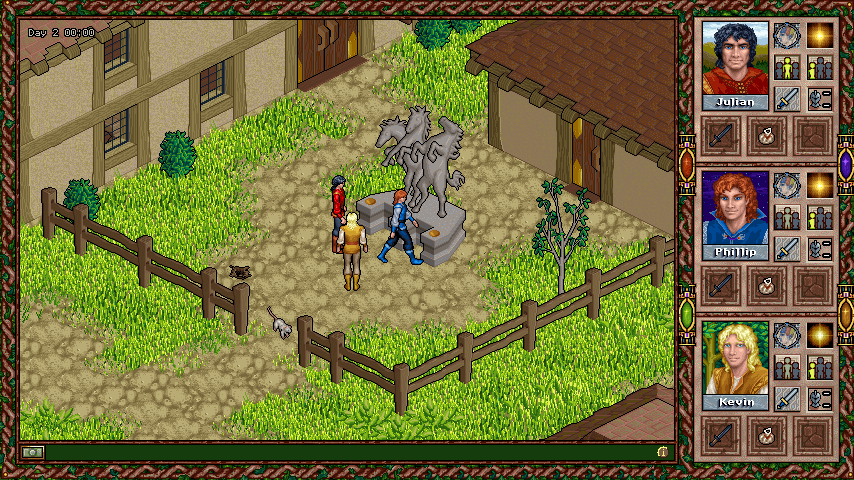

# 🧚 Faery Tale Adventure II: Community Edition

[](https://github.com/Celtian/fta2/actions/workflows/build.yml)
[](https://github.com/Celtian/fta2/releases)
[](LICENSE)

Explore the world of Faery Tale Adventure II with Julian, Phillip and Kevin.
Community Edition runs the original DOS game data directly on Windows, Linux and
macOS, without DOSBox or a ScummVM installation.



*Actual gameplay at 854 × 480. Original game artwork retains its copyright.*

**🚧 Development alpha · version 0.0.1.** Version numbering restarts with
Community Edition; earlier 0.1.x packages remain historical development builds.
A full playthrough, complete translation review and macOS runtime validation are
still pending. See the [validation record](docs/validation.md).

## 📥 Download and play

Choose your platform from **[GitHub Releases](https://github.com/Celtian/fta2/releases)**,
including prereleases. Packages become available when a version tag passes the
release pipeline.

| Platform | Download suffix | Start after extracting the entire ZIP |
| --- | --- | --- |
| Windows x64 | `Windows-x86_64.zip` | `Faery Tale Adventure II.exe` |
| Linux x64 | `Linux-x86_64.zip` | `Faery Tale Adventure II` |
| macOS Apple Silicon / Intel | `Darwin-universal.zip` | `Faery Tale Adventure II.command` |

Each ZIP includes SDL, licence notices and matching engine sources under `source/`.
Checksums are in the release's `SHA256SUMS`. Keep the extracted folder together
when moving the game. Linux/macOS may require allowing execution of the launcher.

**💾 You need your own original game data.** Public downloads do not include the
game, voices or saves. Select the supported English DOS installation with
`--data-dir /path/to/game`; Windows also offers a folder picker. Required files:

```text
FTA2.EXE       FTA.HRS        FTADATA.HRS   FTAIMAGE.HRS
FTASOUND.HRS   SCRIPTS.HRS    DRIVERS/SAMPLE.AD   DRIVERS/SAMPLE.OPL
```

Files are validated before use and opened read-only. Optional verified English CD
voices can be supplied separately. Saves, settings and logs go to your user
profile. See the [player guide](docs/player-guide.md#game-data) for details.

## ✨ What's included

- 🖥️ Classic 640 × 480 rendering or optional 854 × 480 widescreen, with crisp pixel scaling.
- 🌍 English, Czech, Spanish and French; language and other preferences apply immediately.
- 🎒 Optional redesigned sidebar, inventory carrier markers and improved container controls.
- 🎵 Original music and sound effects, with optional original English CD voices.
- 💾 Original-save loading and new saves that retain the original game-state chunks.
- 📸 Print Screen captures the game, cursor and tooltip as a lossless PNG.

**Translation status:** Czech, Spanish and French story catalogs still include
drafts. English voices remain unchanged; missing voices always retain readable
text. [Translation workflow and remaining review](localization/README.md).

## ⌨️ Quick controls

| Key | Action |
| --- | --- |
| `1` / `2` / `3` | Select a brother |
| `Tab` | Toggle group / individual controls |
| `O` | Open Options, including save/load and language |
| `Escape` | Close the frontmost window or open Options |
| `G` | Use the selected brother's carried map |
| Arrow keys | Pan the open map |
| `M` | Toggle music |
| `Alt+Enter` | Toggle fullscreen / windowed mode |
| `Print Screen` | Save a PNG in `screenshots/` beside the game, with a user-profile fallback |

Options → **Hot Keys** shows the keyboard overview. Click **i** at the right end
of the status bar for the edition, author and build version. The
[player guide](docs/player-guide.md) covers all controls, settings, diagnostics
and local complete packages.

## 🛠️ Build from source

Requires a C++20 compiler, CMake 3.24+, Python 3.10+ and platform development
libraries. SDL **3.4.18** is fetched from a checksum-verified archive, or can be
provided through `CMAKE_PREFIX_PATH` with `-DFTA2_FETCH_SDL=OFF` for an offline build.

```sh
cmake -S . -B build -DCMAKE_BUILD_TYPE=Release
cmake --build build --config Release --parallel 4
ctest --test-dir build -C Release --output-on-failure
./build/fta2-ce --data-dir /path/to/game
```

Windows multi-configuration builds place the executable under `build/Release/`.
For macOS universal builds, add `-DCMAKE_OSX_ARCHITECTURES="arm64;x86_64"`.
Public tests use synthetic inputs and need no original game data.

## 🚀 Releases and development

CI and tagged releases share the same [desktop build workflow](.github/workflows/desktop.yml).
The [release pipeline](.github/workflows/release.yml) verifies the version, tests
and audits all three platform ZIPs, then publishes a GitHub prerelease with
SHA-256 checksums. Prepare the next version with one of these commands:

```sh
python3 tools/release.py patch
python3 tools/release.py minor
python3 tools/release.py major
```

Choose one command with a clean working tree. It updates the version, commits and
creates an annotated tag; then run the printed Git push command to start the
release pipeline. Add `--dry-run` to preview. See [release instructions](docs/releases.md)
for examples and manual workflow runs.

- 🧩 [Architecture](docs/architecture.md) and [original resources](docs/dos-resources.md)
- 🧪 [Validation and outstanding acceptance checks](docs/validation.md)
- 🪟 [Windows build instructions](docs/windows-build.md)
- 🔬 [Separate development reference](reference/README.md)
- 🤝 [Repository instructions](AGENTS.md)

## ⚖️ Licences and credits

The engine is **GPL-3.0-or-later**, using selected SAGA2 algorithms from ScummVM.
Nuked OPL3 retains its LGPL-2.1-or-later notices; SDL uses the zlib licence.
See [LICENSE](LICENSE) and [source provenance](third_party/README.md).

Original game data, voices and the gameplay artwork shown above retain their
original copyright. They are not relicensed by this project. The application icon
comes from the [ScummVM community icon collection](third_party/APP-ICON.md).

Community Edition: **Dominik Hladík, 2026**.
